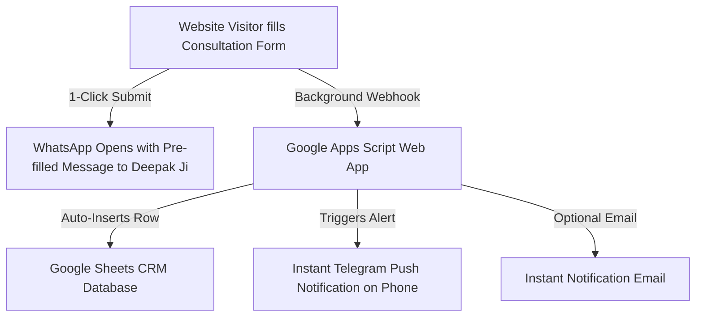

# 🚀 Click Jyotish Lead Automation & Notification Setup Guide

This guide provides a **100% free, automated workflow** to capture leads from your website, store them in a Google Sheets CRM, and send instant push notifications directly to your phone.

---

## 📋 Architecture Overview



---

## 🛠️ Step 1: Create Your Google Sheets CRM

1. Open [Google Sheets](https://sheets.google.com) and create a new blank spreadsheet.
2. Name it: **`Click Jyotish - Consultation Leads CRM`**.
3. In **Row 1**, set up the following column headers:

| Col A | Col B | Col C | Col D | Col E | Col F | Col G | Col H | Col I | Col J | Col K |
|---|---|---|---|---|---|---|---|---|---|---|
| **Timestamp** | **Full Name** | **WhatsApp Phone** | **Email** | **Date of Birth** | **Time of Birth** | **Place of Birth** | **Service Focus** | **Language** | **Preferred Slot** | **Specific Question** | **Status** |

---

## ⚙️ Step 2: Deploy Free Google Apps Script Webhook

1. In your Google Sheet, click on **Extensions** &rarr; **Apps Script**.
2. Replace all existing code in the editor with the script below:

```javascript
/**
 * Click Jyotish - Lead Capture Webhook & Telegram Notification Engine
 */

// 1. CONFIGURATION (Replace with your Telegram Bot credentials if using Telegram)
const TELEGRAM_BOT_TOKEN = "YOUR_TELEGRAM_BOT_TOKEN"; // Optional: From @BotFather
const TELEGRAM_CHAT_ID = "YOUR_TELEGRAM_CHAT_ID";     // Optional: Your personal Telegram Chat ID
const NOTIFY_EMAIL = "support@clickjyotish.in";        // Your email address for notification

function doPost(e) {
  try {
    const sheet = SpreadsheetApp.getActiveSpreadsheet().getActiveSheet();
    const data = JSON.parse(e.postData.contents);

    // Append lead to Google Sheet
    sheet.appendRow([
      new Date(),
      data.name || '',
      data.phone || '',
      data.email || '',
      data.dob || '',
      data.tob || '',
      data.pob || '',
      data.service || '',
      data.language || '',
      data.preferredSlot || '',
      data.question || '',
      'New Lead' // Status: New Lead -> Contacted -> Paid -> Scheduled -> Completed
    ]);

    // Send Instant Telegram Notification (Optional)
    if (TELEGRAM_BOT_TOKEN && TELEGRAM_BOT_TOKEN !== "YOUR_TELEGRAM_BOT_TOKEN") {
      sendTelegramAlert(data);
    }

    // Send Instant Email Notification
    if (NOTIFY_EMAIL) {
      sendEmailAlert(data);
    }

    return ContentService
      .createTextOutput(JSON.stringify({ status: "success", message: "Lead recorded successfully" }))
      .setMimeType(ContentService.MimeType.JSON);

  } catch (error) {
    return ContentService
      .createTextOutput(JSON.stringify({ status: "error", message: error.toString() }))
      .setMimeType(ContentService.MimeType.JSON);
  }
}

// Telegram Push Alert Function
function sendTelegramAlert(data) {
  const message = 
    `🔔 *NEW CONSULTATION REQUEST - Click Jyotish*\n\n` +
    `👤 *Name:* ${data.name}\n` +
    `📞 *Phone:* ${data.phone}\n` +
    `📧 *Email:* ${data.email}\n` +
    `✨ *Service:* ${data.service}\n` +
    `🗓️ *DOB:* ${data.dob} | ${data.tob}\n` +
    `📍 *Place:* ${data.pob}\n` +
    `🗣️ *Language:* ${data.language}\n` +
    `⏱️ *Slot:* ${data.preferredSlot}\n\n` +
    `💬 *Question:* "${data.question}"`;

  const url = `https://api.telegram.org/bot${TELEGRAM_BOT_TOKEN}/sendMessage`;
  const payload = {
    chat_id: TELEGRAM_CHAT_ID,
    text: message,
    parse_mode: 'Markdown'
  };

  UrlFetchApp.fetch(url, {
    method: 'post',
    contentType: 'application/json',
    payload: JSON.stringify(payload)
  });
}

// Email Notification Function
function sendEmailAlert(data) {
  const subject = `[New Consultation Lead] ${data.name} - ${data.service}`;
  const body = 
    `You have received a new consultation request on Click Jyotish:\n\n` +
    `Name: ${data.name}\n` +
    `Phone: ${data.phone}\n` +
    `Email: ${data.email}\n` +
    `Service: ${data.service}\n` +
    `Date of Birth: ${data.dob}\n` +
    `Time of Birth: ${data.tob}\n` +
    `Place of Birth: ${data.pob}\n` +
    `Language: ${data.language}\n` +
    `Preferred Time Slot: ${data.preferredSlot}\n\n` +
    `Primary Concern / Question:\n${data.question}\n\n` +
    `Direct WhatsApp Link: https://wa.me/${data.phone.replace(/[^0-9]/g, '')}`;

  MailApp.sendEmail(NOTIFY_EMAIL, subject, body);
}
```

3. Click **Deploy** &rarr; **New deployment**.
4. Click the **Gear icon (Select type)** &rarr; Choose **Web app**.
5. Set:
   * **Description**: `Click Jyotish Lead Capture`
   * **Execute as**: `Me`
   * **Who has access**: `Anyone` (essential so the website can post data)
6. Click **Deploy**, authorize permissions, and copy the **Web app URL** (e.g. `https://script.google.com/macros/s/AKfy.../exec`).

---

## 🔗 Step 3: Link Webhook URL to Your Website

Open [`vaidik-jyotish/src/components/ConsultationForm.astro`](file:///c:/Users/Deepaak/Documents/Codex/2026-07-26/i/vaidik-jyotish/src/components/ConsultationForm.astro) and replace:
```javascript
const webhookUrl = 'https://script.google.com/macros/s/AKfycbz_SAMPLE_APP_SCRIPT/exec';
```
with your copied Google Apps Script Web App URL.

---

## 📲 Step 4: How the Instant WhatsApp Flow Works

When a client clicks **Book 15-Minute Consultation**:
1. All birth parameters (DOB, Time, City, Question) are validated.
2. The lead is saved in the browser cache and dispatched to your Google Sheet webhook.
3. WhatsApp opens automatically on the client's screen addressed to **+91 7669655530** with a pre-written, formatted message.
4. All the client has to do is tap **Send**!
